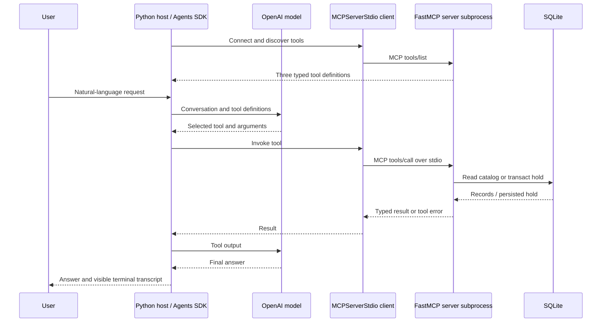

# Campus Library MCP Toolkit

**Yasmina Hanna - EECE 503P/798S: Agentic Systems - C5: Agent Tools**

A complete three-tool teaching project built with FastMCP and the OpenAI Agents SDK. It searches a fictional campus catalog and saves real local SQLite holds.

## Tool contracts

| MCP tool | Category | Inputs | Typed output | Predictable failure |
|---|---|---|---|---|
| `search_catalog` | Data | `query: str` (1-100 characters), `available_only: bool = False` | `SearchResult`: normalized query, count, `Book[]` | Blank query -> `INVALID_QUERY` |
| `create_hold` | Action | `book_id: str` (`B` + 3 digits), `student_id: str` (`S` + 4 digits) | `HoldResult`: created/existing status, hold ID, book/student IDs, UTC timestamp, message | Missing book -> `BOOK_NOT_FOUND`; no copies -> `BOOK_UNAVAILABLE` |
| `reserve_book` | Orchestration | `query: str`, `student_id: str` | `ReservationResult`: selected book with current availability, hold, execution steps | No match -> `NO_MATCH`; all unavailable -> `NO_AVAILABLE_BOOK` |

Pydantic field constraints also reject malformed IDs and oversized inputs before execution. Storage failures are reported as `STORAGE_UNAVAILABLE`. Domain errors become MCP tool errors, rather than success-shaped responses. Empty search results are successful lookups. The Python models in `campus_library/models.py` define output schemas.

Exactly three functions have `@mcp.tool`. No resources are exposed, so `@mcp.resource` is not needed: the optional resource instruction applies only when exposing data as a resource. The queryable Data capability remains a tool discoverable by the agent.

## Architecture



`agent.py` is the host application; `MCPServerStdio` is its MCP client integration; `server.py` runs the server. The model requests a tool, and the SDK executes it through MCP. The model does not connect directly to the local database.

`reserve_book` calls the **same Python service methods** wrapped by the Data and Action tools. Internal calls stay inside the server; they do not recursively invoke MCP or ask another model. Its returned `steps` show these operations. One external `reserve_book` call is therefore expected in the host trace.

Search is case-insensitive; all whitespace-separated query terms must occur in the combined ID/title/author/topic. Results are ordered by book ID. Reservations try matches in that order, skip `BOOK_UNAVAILABLE`, and stop after the first successful or existing hold. A final lookup refreshes the returned available count. The catalog is seeded at startup; the Data tool itself uses a read-only database connection.

The Action tool is idempotent per `(book_id, student_id)`: retries return the existing hold without consuming another copy. `BEGIN IMMEDIATE` serializes hold transactions and prevents oversubscription. Orchestration is conservatively marked non-idempotent because catalog changes could change the selected book; its individual hold writes remain duplicate-safe.

## Setup (Windows PowerShell)

Use Python **3.11 or newer**, with a version supported by all installed packages. This project was verified on Python 3.14. Keep the project in one folder, including its `campus_library`, `scripts`, `tests`, and `docs` directories.

```powershell
python -m venv .venv
.\.venv\Scripts\python.exe -m pip install -r requirements.txt
Copy-Item .env.example .env
```

Edit `.env` locally and put your API key after `OPENAI_API_KEY=`. Do not put the key in source code or on screen. `OPENAI_MODEL` defaults to `gpt-4.1-mini`; set a tool-capable model that your API project can access. This default is a configurable example, not a claim that it is the latest model. An API account with available quota and internet access is required for live model calls. The MCP checks and automated tests require no API key.

Explicit `.venv` commands avoid PowerShell activation-policy problems. For macOS/Linux use `python3 -m venv .venv` and `.venv/bin/python` in place of the Windows interpreter path.

## Verify without an API key

```powershell
.\.venv\Scripts\python.exe -m pytest -q
.\.venv\Scripts\python.exe -m scripts.mcp_demo
```

The first command verifies business logic, schemas, errors, concurrency, and the SDK/stdio integration. The second starts a real FastMCP subprocess, discovers the three tools, and invokes success and error cases through the **Agents SDK MCP client**. It prints the real request/response data. It does not use an LLM and is not a substitute for the required live-agent demonstration.

Tests and protocol checks use fresh temporary databases and leave your persistent holds untouched. The SDK integration test uses a clearly labeled scripted model so the tool round trip can be verified without external API credentials; it does not measure a real model's routing ability.

## Interactive mode and persistence

```powershell
.\.venv\Scripts\python.exe -m campus_library.agent
.\.venv\Scripts\python.exe -m campus_library.agent --prompt "Search for databases without creating a hold."
```

Interactive mode uses `data/library.sqlite3` by default. Set `LIBRARY_DB_PATH` in `.env` for a separate database. To start fresh without deleting anything, choose a new path. The server initializes missing databases automatically. All holds are demo records and stay active; expiry and cancellation are out of scope.

To launch only the server, run `.\.venv\Scripts\python.exe -m campus_library.server`. It waits for an MCP client on stdin; no browser or HTTP port is expected. Server stdout carries protocol traffic; host transcripts are printed by the separate host process.

## Project files

```text
campus_library/
  models.py          Typed output schemas
  service.py         Search, SQLite action, orchestration
  server.py          Exactly three FastMCP tools
  agent.py           Agents SDK host and live demo
scripts/mcp_demo.py  Real key-free stdio protocol check
tests/               Service, MCP, and SDK integration tests
docs/
  written_summary.md 300-400 word reading summary and references
  reflection.md      Two-paragraph reflection
  speaker_notes.md   Timed narration, screen actions, commands
  submission.md      Submission fields and checklist
verification/        Actual local verification evidence
README.md            Setup and architecture
requirements.txt     Exact top-level package versions
requirements-lock.txt Full resolved Python package versions
```

## Troubleshooting

- **Missing key:** edit `.env`; the program checks for a nonblank key and exits with setup instructions. Keep the key private; no key is needed for tests.
- **API authentication, quota, model access, or connection failure:** confirm your API account and network, and set `OPENAI_MODEL` to an accessible tool-capable model. The CLI returns an error instead of reporting a fabricated result.
- **No tools or startup timeout:** install dependencies into the interpreter you are using. Run from the project root. The client uses `sys.executable`, an absolute working directory, and a 30-second MCP timeout.
- **Known book unavailable:** this is a domain failure, not a broken connection. Use another title or rerun `--demo` for a fresh temporary database.
- **Catalog query has no results:** try a shorter topic. There is no web search or semantic retrieval; matching is deterministic token-based substring search.
- **Tests and recording show different hold IDs:** IDs and UTC timestamps are generated at execution. Compare tool names, status, book IDs, and error codes rather than a literal UUID.

## Submission and status

The source, written summary, reflection, notes, and a ZIP package are prepared. Local verification evidence is in `verification/`. A live OpenAI model run has passed all four recording scenarios; `verification/live_agent_results.json` contains the actual prompts, MCP calls, results, and model answers. To repeat this billable check, run `python -m scripts.live_check` with your private API key configured. Record and upload your own 5-7 minute screencast, publish the source to your repository, and put both URLs in `docs/submission.md`. No external repository or video has been created by this project.

## Implementation references

- [FastMCP tools](https://gofastmcp.com/servers/tools): decorator, schemas, annotations, and tool errors.
- [Official OpenAI Agents SDK integration guidance](https://developers.openai.com/api/docs/guides/agents/integrations-observability): SDK-managed local MCP connections.
- [MCP architecture](https://modelcontextprotocol.io/docs/learn/architecture): host/client/server roles.
- [Reading summary and its source references](docs/written_summary.md).
